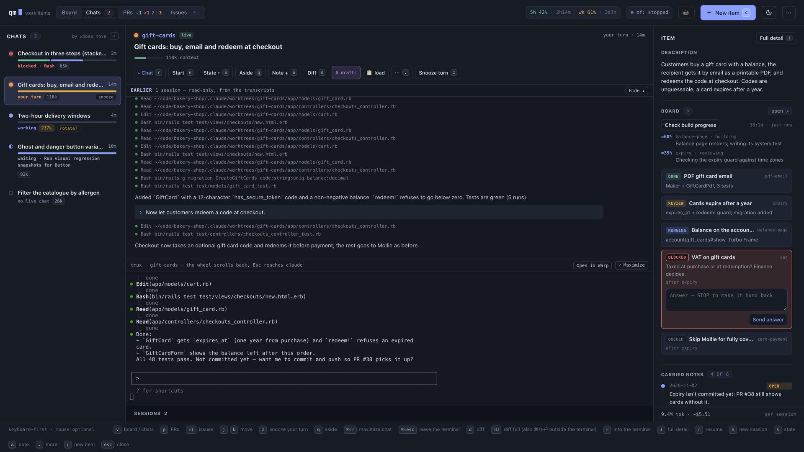
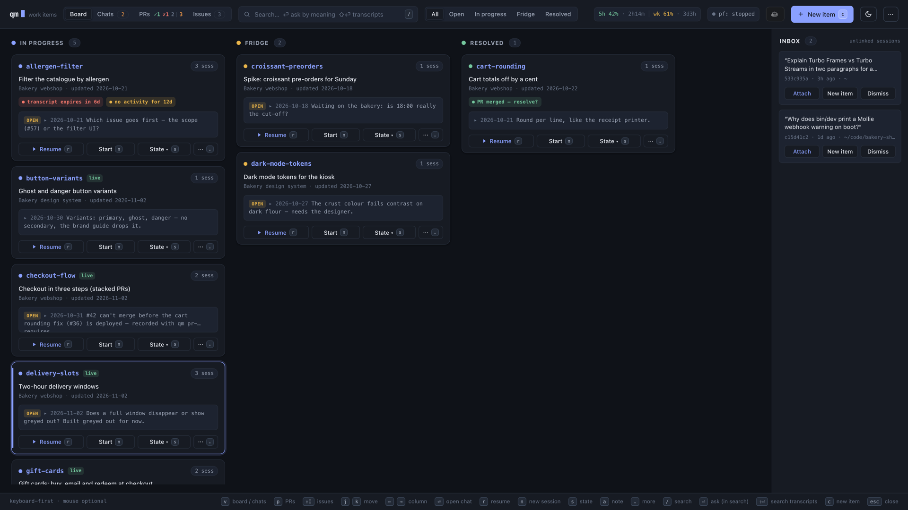
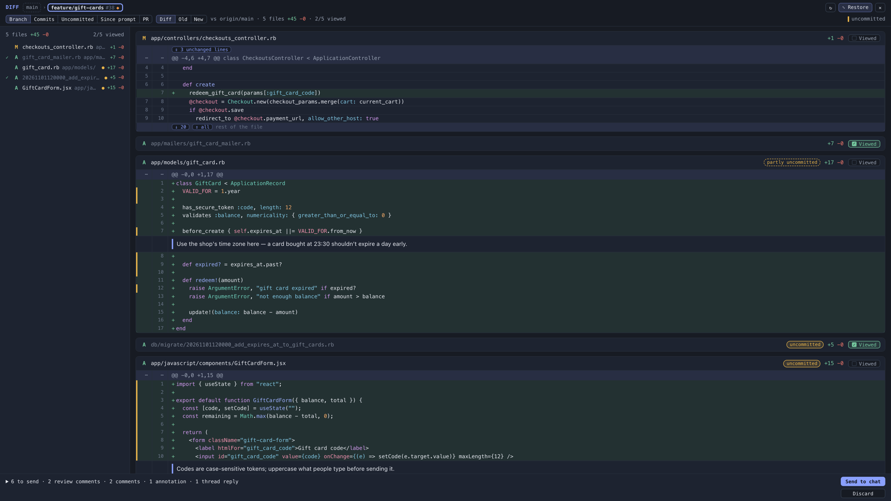
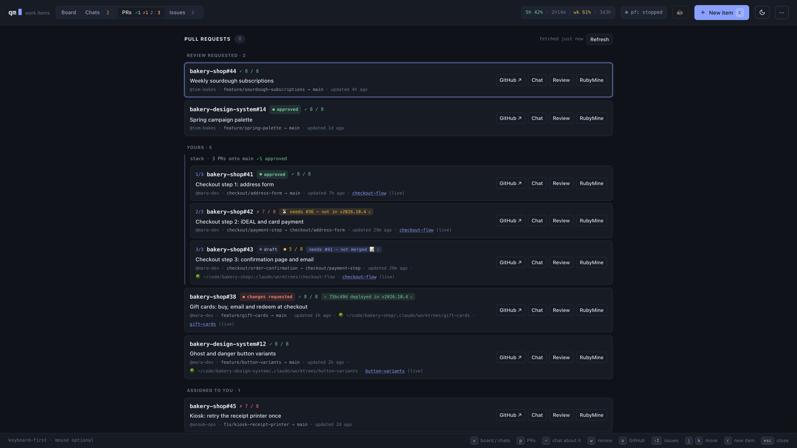
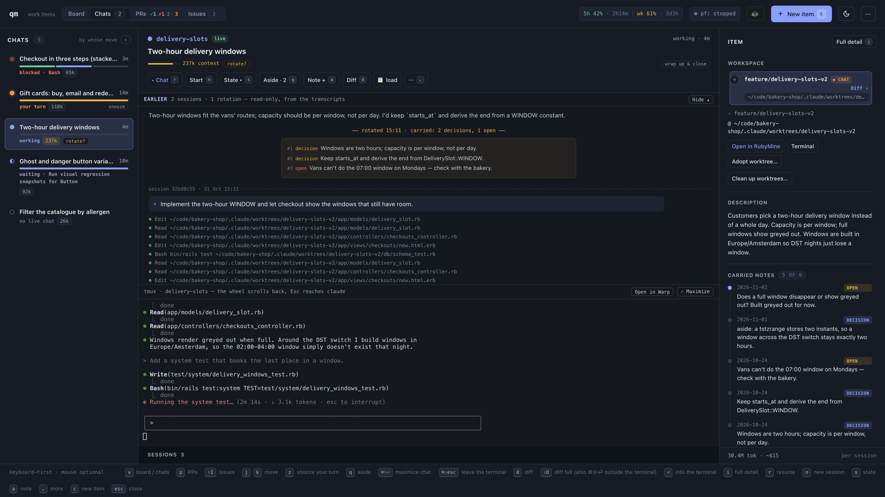
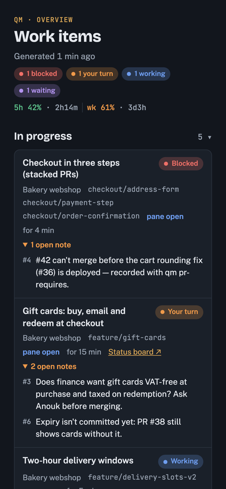

# Quartermaster (`qm`)

Quartermaster tracks every [Claude Code](https://claude.com/claude-code) session on your
machine and lets you curate them into **work items**: a markdown file per piece of work with a
state (`in_progress` / `fridge` / `resolved`), notes, and links to its branch, worktree, issue
and PR. Capture is automatic (Claude Code hooks append to a JSONL log); curation happens in
three places:

- **`qm`**, the CLI: bare `qm` is an fzf viewer; `qm help` lists every command.
- **`qm gui`**, a loopback web app: a kanban board, the item's Claude chats running in tmux
  panes, diffs with review comments, PRs, issues, stacked branches, and worktree cleanup.
- **A phone page** published as a claude.ai artifact (the `/work-items` skill).

A SessionStart hook tells each session which work item it belongs to and how to keep it
current, so Claude itself writes the notes.

> [!WARNING]
> **This project is 100% vibe-coded.** Claude Code wrote essentially all of it, steered by
> one person for their own daily use. There are no guarantees whatsoever about its quality,
> correctness, security or safety, and it is provided as-is under the [MIT license](LICENSE),
> without warranty of any kind. Read the code before you run it, and use it at your own risk.
>
> It is a personal tool shared in case it is useful: expect rough edges, breaking changes
> without notice, and issues or pull requests that may go unanswered.



## Screenshots

All taken on the made-up demo world in [`showcase/`](showcase/README.md).

| | |
|---|---|
|  |  |
| **Board**: every work item by state, with whose turn it is. | **Diff**: a branch, PR or since-prompt diff, with review comments. |
|  |  |
| **PRs**: your PRs and review requests, with checks and threads. | **Rotation**: a chat handed to a fresh session, notes carried over. |



**Phone page**: the work items and whose turn it is, as a claude.ai artifact you can open
anywhere.

<br clear="right">

## Requirements

- **macOS** (see [macOS-only pieces](#macos-only-pieces); other platforms are untested).
- **Ruby ≥ 3.3** as `ruby` on `PATH` (stdlib only, no gems).
- **Claude Code**, **git**, **tmux** (the GUI's chats) and **fzf** (the terminal viewer).
- **gh**, logged in, for PRs, issues and reviews, plus the gh-stack extension (`gh stack`) for
  stacked branches. Everything GitHub works offline too, just without that data.

Everything else is optional: see [Optional features](#optional-features).

## Install

```sh
git clone <this repo> ~/code/quartermaster
ln -s ~/code/quartermaster/quartermaster ~/bin/qm   # any directory on PATH
qm install-hooks                                     # prints the hooks snippet
```

1. **Hooks.** `qm install-hooks` prints the `hooks` block for `~/.claude/settings.json`, with
   absolute paths into your checkout. qm never writes that file: merge the block in yourself.
   Keep the checkout where it is afterwards; the hooks point at it.
2. **Skills.** Link the [bundled skills](#bundled-skills) you want into `~/.claude/skills/`.
3. **Status line** (optional, but it is where qm learns your rate limits):
   `ln -s ~/code/quartermaster/statusline/statusline.rb ~/.claude/statusline.rb` and set
   `"statusLine": {"type": "command", "command": "/usr/bin/ruby ~/.claude/statusline.rb"}` in settings.json.
4. Start a Claude Code session anywhere. qm creates `~/.claude/quartermaster/` (override with
   `QM_ROOT`) with a near-empty `config.yml`. Run `qm gui` and open the URL it prints, then add
   your projects in the ⚙ Settings view (`,`) or with `qm config set` (see [config.yml](#configyml)).

## Optional features

Each feature below needs something beyond the requirements. A feature behind a config key is
off while that key is unset: its buttons stay hidden, and `qm ide` or a dev-server command
refuses with a message naming the setting. The keys are in [config.yml](#configyml).

### Bundled skills

`skills/` holds Claude Code skills qm's buttons and sessions rely on. Link each one you want:

```sh
for s in rotate work-items branch-stats adopt-worktree draft-issues; do
  ln -s ~/code/quartermaster/skills/$s ~/.claude/skills/$s
done
```

| Skill | What uses it |
|---|---|
| `rotate` | `/rotate` in a qm chat: hand the work item to a fresh session |
| `work-items` | the [phone page](#phone-page) |
| `branch-stats` | how big a branch is (the GUI runs its script from the repo, linked or not) |
| `adopt-worktree` | the side panel's **Adopt worktree…**: move a worktree's branch into the main checkout |
| `draft-issues` | the GUI's Issues pane: issue drafts revised in place before they are created |

### Dev server

**Switch &lt;command&gt;** (and, with an [IDE](#ide) set, **Work on this**) hands one dev
server between checkouts. Needs a per-project `dev_server:` whose `command` you provide: qm runs `command switch PATH MODE`,
`command stop` and `command status` (exit 0 while it serves). `modes` lists the modes it
accepts (e.g. `dev`, `tunnel`) and `default_mode` the one a plain switch uses. To show what it
serves, give `status_url` (JSON `{mode, root, switching}`) or `state_file` (`<mode> <root>`).

### Test database per worktree

Per-project `test_db:` names a command: a new worktree runs `<test_db> prepare` in it, and
worktree cleanup runs `<test_db> drop PATH [--dry-run]`.

### IDE

**Open in &lt;label&gt;**, the IDE half of **Work on this**, the PRs view's IDE button and
`qm ide` need `ide_command:`, an argv array with a literal `PATH` placeholder:
`[open, -a, MyIDE, PATH]`, `[code, PATH]`, or a shell script such as `[zsh, -ic, "myide PATH"]`
(`PATH` inside a longer element is shell-escaped). `ide_label:` names it in buttons and messages
(default `IDE`). Set them at the top level; a project may override both.

### Benchmarks

The 🏁 branch benchmarks measure a branch against main, stage by stage for a stack. They assume
a Rails app on Postgres and need a per-project `benchmark:` with both `database` (a Postgres
database a run reads, or clones as a template for a case that writes; fill it with
production-sized data yourself) and `skill` (a folder you write, holding a `SKILL.md` on how
to benchmark your app and a `bin/example_bench.rb`); `notes` adds prompt lines. Not bundled.

### Review skill

The PRs view's **Review** types a review skill into the item's chat: `/code-review` by default,
or the per-project `review_skill:`.

### Loose-chat starters

`loose_starters:` presets fill "Start with" in the loose-chat dialog (`qm loose --starter`).
Each prompt loads something, typically through the chat's own MCP server (an issue tracker,
say), and ends mid-sentence: qm appends " answer my question about them: …" or " ask me what I
want to know about them.".

### Status board and build progress

The side panel's **Board** mirrors a status-board artifact and **Check build progress**
estimates how far running sub-agents are. Both are fed by a `delegate-build`-style skill of your
own, not bundled: it publishes a claude.ai artifact whose database holds one row per task in
collection `tasks` (`status`, `title`, `note`, `order`, `dependsOn`, `batch`, `batchLabel`,
`updatedAt`), writes it with `ArtifactData`, and links it to the item with
`qm board SLUG URL [--answers-dir DIR]`. The PostToolUse hook from `qm install-hooks` records
every `ArtifactData` call, so the GUI renders the board without reaching claude.ai. A
`blocked` row gets an answer box that writes `<answers dir>/<doc_id>.md` for the agent to wait
on. Build progress reads the Workflow runs of the item's sessions and asks `claude -p --model
haiku` for an estimate, only on your click.

### Phone page

Needs claude.ai Artifacts with a database. Ask Claude to publish `skills/work-items/page.html`
once with `capabilities: {db: {rules: [{path: "", read: "view", write: "owner"}]}}`, put its URL
in `overview_artifact:`, and link the `work-items` skill. Then "show my work items" in any
session refreshes it. To act on items from the phone, talk to a qm chat through Claude's Remote
Control.

### Automations

Manage your claude.ai cloud routines (scheduled Claude Code agents that run on claude.ai) from
qm: each one is a work item with its schedule and prompt in local files. The ⚙ Automations tab
and `qm automation list | show | adopt | push | pull | pause | resume | run | delete` list
them, adopt the ones you already have, and push your edits; `qm automation new` and **Edit with
Claude** create or change one through the item's chat. Off until
`qm config set automations.token_source claude_code`, because it uses your Claude Code login
(see [What qm does on your machine](#what-qm-does-on-your-machine)). Details:
[docs/areas/automations.md](docs/areas/automations.md).

### Other tools

- **ripgrep** (`rg`): transcript search.
- **terminal-notifier**: clickable notifications that open the chat (else plain `osascript` ones).
- **Warp**: the "open in a terminal tab" actions (`qm resume`, `qm term`).
- **Arc**: a notification's click brings the GUI's tab to that chat.

### macOS-only pieces

- Notifications: `osascript` (or terminal-notifier).
- Opening URLs, Warp tabs and the GUI: `open`; focusing the GUI tab in Arc: `osascript`.
- Keeping the Mac awake while chats work (`qm caffeinate`): `/usr/bin/caffeinate`.
- The status line runs under macOS's system Ruby, `/usr/bin/ruby`.
- Automations read Claude Code's login from the keychain: `security`.

## config.yml

`~/.claude/quartermaster/config.yml` maps project names to repo roots. Sessions in a repo (or
its worktrees) get that project; everything else is "No project". A project is a plain path,
or a mapping with `root:` plus optional feature keys. A missing key leaves that feature off.

Edit it in `qm gui`'s ⚙ Settings view (the header's cog, or `,`), with
`qm config get | set | unset | path` (`qm config set projects.my-app ~/code/my-app`), or by
hand. Both editors check the whole file and refuse to write one with errors. They rewrite it in
qm's own layout, so **comments you add by hand are dropped** on their next save; the previous
file is kept as `config.yml.bak`.

```yaml
projects:
  my-app: ~/code/my-app
  my-web-app:
    root: ~/code/my-web-app
    dev_server:                   # one dev server, switched between checkouts
      command: devserver          # qm runs: devserver switch PATH MODE | stop | status
      modes: [dev, tunnel]
      default_mode: dev
      status_url: http://localhost:3000/status   # optional, JSON {mode, root, switching}
      state_file: ~/.cache/devserver/current     # optional, "<mode> <root>"
    test_db: my-test-db           # new worktree: my-test-db prepare; cleanup: my-test-db drop PATH [--dry-run]
    review_skill: /review-my-pr   # the PRs view's Review button (default /code-review)
    pr_prerequisites: true        # PRs ship by release: sessions learn `qm pr-requires`
    benchmark:                    # 🏁 branch benchmarks (a Rails app on Postgres)
      database: my_app_benchmark  # the database a run reads, or clones for a writing case
      skill: ~/.claude/skills/benchmark   # holds SKILL.md and bin/example_bench.rb
      notes: Use nothing outside the bundle.   # optional extra prompt lines
    ide_command: [code, PATH]     # this project's own IDE, overriding the global one
    ide_label: VS Code

default_project: my-app           # where a bare issue number starts (default: the first project)

ide_command: [open, -a, MyIDE, PATH]   # "Open in …": PATH becomes the checkout
ide_label: MyIDE                       # the buttons' name (default IDE)

loose_starters:                   # presets in the loose-chat dialog's "Start with"
  backlog:
    label: Sprint backlog
    # qm appends " answer my question about them: …" or " ask me what I want
    # to know about them.", so the prompt ends mid-sentence, ready for that.
    prompt: Load the open issues of the current sprint. Don't change code. Then give a one-line count of them and

automations:
  token_source: claude_code       # turns on Automations: qm uses Claude Code's login token

# prices:                         # per-model token price overrides (docs/areas/side-panel.md)
# overview_artifact: <URL>        # the published phone page's artifact URL
```

`docs/overview.md` describes each key, and the area pages under `docs/areas/` what it turns on.

## What qm does on your machine

Know this before you install it:

- **Its hooks run in every Claude Code session**, on session start and end, on every prompt
  and on every tool call. They append to files under `~/.claude/quartermaster/`: session and
  tool-call events (session ids, working directory, branch, tool names), commit and diff
  stats at session end, a git snapshot of the worktree on each prompt, and the full payload of
  every `ArtifactData` call. qm also reads your Claude Code transcripts under
  `~/.claude/projects/`.
- **`qm gui` listens on `127.0.0.1` only** and refuses requests from other origins, but
  anything on your machine that can reach that port can drive it, and it can run commands:
  tmux chats running `claude`, `git worktree` add and remove, `gh`, and whatever dev-server,
  test-database and IDE commands you configure.
- **Some features start `claude -p` in the background** (summaries, asides, benchmarks), which
  counts against your Claude usage or API bill.
- **With [Automations](#automations) on, qm reads Claude Code's login token from the macOS
  keychain** (`security find-generic-password -s "Claude Code-credentials"`) and your
  organization id from `~/.claude.json`, on every call. The token is never stored, logged or
  refreshed; an expired one is yours to renew by opening Claude Code. The routines it manages
  run in the cloud on their schedule, with the connectors listed in each automation's file.
- **qm sends nothing itself, except to `api.anthropic.com` with Automations on**: the routines
  API, called directly with that token, only while you use the Automations tab or
  `qm automation`.
  Everything else goes through the tools it calls: `gh` (GitHub), `claude` (Anthropic), and the
  claude.ai artifacts you choose to publish.

## Development

```sh
ruby test/quartermaster_test.rb
```

Tests run against a temporary `QM_ROOT` and their own tmux socket, never your live data. Start
with [`CLAUDE.md`](CLAUDE.md) (the hard constraints) and [`docs/README.md`](docs/README.md),
which indexes one page per area. `showcase/` builds a fake demo world to run the real GUI on
made-up data.

## License

[MIT](LICENSE)
